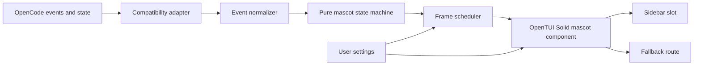

# RithBot — Technical Architecture

**Status:** Proposed architecture; interfaces below describe an implementation direction, not a validated OpenCode plugin build.

> **V2 implementation update (2026-10-24):** See [../README.md](../README.md) and `src/tui.tsx` for the actual implementation. The V1 `@opencode-ai/plugin/tui`, `tui.json`, and underscore slot names mentioned below are historical. V2 uses `@opencode/plugin/tui`, `cli.json`, `context.ui.slot({ append: "sidebar.content", ... })`, `context.ui.router`, `context.keymap.layer`, and `context.data.listen`. The project intentionally remains CLI-only and never edits server configuration.

## System boundary

RithBot is a **presentation extension** for OpenCode TUI. OpenCode controls the AI session, prompts, models, tools and host UI. RithBot consumes available status information and renders a text-based mascot.



## Recommended folder structure

```text
RithBot/
├── README.md
├── PROJECT_PLAN.md
├── ARCHITECTURE.md
├── TESTING_AND_RELEASE.md
├── CONTRIBUTING.md
├── LICENSE                     # add before public release
├── package.json                # add during implementation
├── tsconfig.json               # add during implementation
├── src/
│   ├── index.ts                # public entrypoint / TUI plugin module
│   ├── host/
│   │   ├── adapter.ts          # translate host SDK state / events
│   │   └── compatibility.ts    # version checks and guardrails
│   ├── mascot/
│   │   ├── states.ts           # pure state types, reducer and precedence
│   │   ├── frames.ts           # frame packs / dimensions
│   │   └── scheduler.ts        # animation timing and cleanup
│   ├── ui/
│   │   ├── Mascot.tsx          # OpenTUI Solid component
│   │   ├── Sidebar.tsx         # sidebar slot surface
│   │   └── Route.tsx           # dedicated UI fallback
│   └── config/
│       ├── defaults.ts
│       └── validate.ts
├── test/
│   ├── states.test.ts
│   ├── scheduler.test.ts
│   ├── frames.test.ts
│   └── fixtures/
├── examples/
│   └── tui.example.json
└── .github/
    ├── workflows/ci.yml
    └── ISSUE_TEMPLATE/
```

## State model

```ts
type MascotState = "idle" | "thinking" | "coding" | "done" | "error";

type MascotEvent =
  | { type: "SESSION_BUSY" }
  | { type: "TOOL_STARTED" }
  | { type: "TOOL_FINISHED" }
  | { type: "SESSION_IDLE" }
  | { type: "SESSION_FAILED" }
  | { type: "NEW_REQUEST" }
  | { type: "RESET" };
```

### Transition policy

| Input/event | Mascot state | Notes |
|---|---|---|
| No active session | `idle` | Do not infer activity |
| New request / session busy | `thinking` | Default busy state |
| Tool starts | `coding` | Tools may represent reads/search too; `coding` is friendly shorthand |
| Tool finishes, session still busy | `thinking` | Remain busy until idle signal |
| Session idle after a request | `done` | Show briefly, then idle according to UX setting |
| Session error | `error` | Error should remain visible until recovered |
| New request after error/done | `thinking` | Start new lifecycle |

For overlapping tools, use a count or active-tool ID set; a single tool finish should not mark the session done if another tool remains active. Handle out-of-order events and session changes. State is supplementary and must not claim exact progress percentages.

## Technical integration

The OpenCode TUI plugin specification describes `@opencode-ai/plugin/tui` with `api.slots.register`, `api.route.register`, `api.keymap.registerLayer`, `api.theme.current`, `api.state`, `api.event.on`, and lifecycle cleanup. The reference host has a `sidebar_content` slot with `session_id` context and `home_logo` / prompt slots. These APIs are version-sensitive; validate exact types by inspecting installed dependency declarations before writing final code.

**Do not confuse:** A TUI module configured through `tui.json` is not the same as a server plugin loaded by `opencode.json` / global `plugins/` directory.

### Recommended mount strategy

1. Try the `sidebar_content` slot for active sessions.
2. Use a compact visual if sidebar dimensions are tight.
3. Register a dedicated `rithbot` route accessible through a command for fallback/testing.
4. Do not use arbitrary terminal cursor repositioning; let the OpenTUI host manage rendering.
5. Avoid forking OpenCode unless the validated plugin API cannot meet core needs.

## Animation architecture

- Store frames as arrays of equal-height strings, with display-cell width normalization.
- Target an initial 2–4 FPS, to be benchmarked rather than hard-coded as a performance guarantee.
- Use a single scheduler per visible mascot; clean up on unmount.
- Support `motion: 'off'` where one stable frame displays all state labels.
- Never block UI input; avoid excessive reflows when terminal resizing.
- Add an ASCII-only skin where Unicode isn't aligned correctly.

## Configuration proposal (not guaranteed schema)

```json
{
  "skin": "robot",
  "motion": "full",
  "fps": 3,
  "showStatusText": true,
  "compactBelowColumns": 90
}
```

This is a **RithBot settings object**, not a paste-ready `tui.json` schema. Determine valid plugin option nesting and persistence only after version checking.

## Dependency and build constraints

- Use versions verified with the installed OpenCode host, not floating latest dependencies by assumption.
- The UI renderer needs host-compatible `@opentui/solid` and `solid-js` versions. Test bundling vs externalization before publication.
- The TUI package export must point to the tested built entrypoint and follow the module shape that the host actually recognizes.
- CI should produce distributable artifacts and verify exported entrypoints.
- If external plugin rendering is broken on a given host release, document it clearly and use a fallback where supported.

## Data & security

Only state and event kinds needed for display should be consumed. No telemetry in v0.1. Never persist prompts, conversation text, file paths, API credentials, tokens, environment variables, or source code. Diagnostic logs should only include safe event names and generic error classifications, and be opt-in where feasible.

## Decision log (initial)

| Decision | Selection | Reason |
|---|---|---|
| Product type | OpenCode TUI plugin | Reusable without maintaining a full OpenCode fork |
| First renderer | Text/Unicode sprite | Most portable terminal representation |
| Behavior | Pure state machine | Testable and decoupled from host APIs |
| UI target | Sidebar slot | Desired always-visible right-hand companion |
| Fallback | Dedicated route | Isolates sidebar compatibility problems |
| Default motion | Low FPS | Performance-friendly baseline |
| Persistence | Minimal | Simple, privacy-preserving plugin |

## Primary references

- https://opencode.ai/docs/plugins
- https://github.com/anomalyco/opencode/blob/dev/packages/opencode/specs/tui-plugins.md
- https://github.com/anomalyco/opencode/blob/dev/packages/tui/src/feature-plugins/sidebar/context.tsx
- https://github.com/anomalyco/opencode/issues/34050
